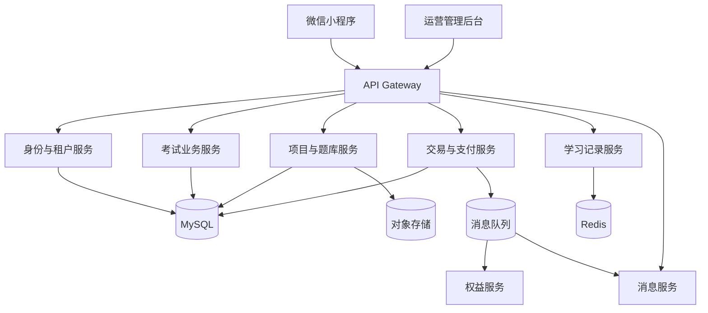

# 综合考试平台微服务技术设计说明书

**版本：** V1.1  
**技术形态：** 微信小程序 + Java 微服务 + 独立运营后台

## 1. 技术基线建议

| 层次 | 建议技术 | 说明 |
|---|---|---|
| 小程序 | 微信原生 / uni-app（二选一） | 项目启动前统一技术路线 |
| 运营后台 | Vue 3 + TypeScript + Element Plus | 独立 Web 管理端 |
| 后端 | Java 17/21 + Spring Boot 3.x | 统一 JDK 与框架版本 |
| 服务治理 | Spring Cloud Alibaba 或 Spring Cloud | 根据团队基础选定，不混搭 |
| ORM | MyBatis-Plus / MyBatis | 统一分页、审计和租户拦截 |
| 数据库 | MySQL 8.x | InnoDB，utf8mb4 |
| 缓存 | Redis | 会话、热点配置、限流、短期状态 |
| 消息 | RabbitMQ / RocketMQ | 统一选型，支付权益等异步事件 |
| 文件 | S3 兼容对象存储 | 题目图片、课程附件、导入文件 |
| 搜索 | MySQL 起步，后续 Elasticsearch | 首期避免过早引入 |
| 可观测 | Micrometer + Prometheus + Grafana + 日志平台 | 指标、日志、链路追踪 |

以上为建议基线，最终版本须结合公司基础设施、运维能力和采购约束确定。

## 2. 总体架构



## 3. 服务边界

首期建议采用“模块化单体 + 核心服务独立部署”的渐进式方案，不以服务数量作为微服务成熟度指标。

| 服务/模块 | 职责 | 核心数据 |
|---|---|---|
| gateway | 路由、鉴权前置、限流、灰度 | 路由配置 |
| identity-tenant | 登录、用户、角色、租户、组织 | 用户、租户、角色 |
| exam-project | 项目、科目、章节、知识点 | 项目、科目 |
| question-bank | 题目、解析、标签、导入审核 | 题目及版本 |
| paper | 试卷模板、组卷、试卷快照 | 试卷、题目快照 |
| exam-engine | 场次、报名、考试、答题、交卷、判分 | 场次、准考、答题 |
| learning | 练习、错题、收藏、学习进度 | 练习记录 |
| trade | 商品、订单、支付、退款 | 订单、支付单 |
| entitlement | 会员、题库授权、课程权益 | 权益账户、流水 |
| course | 课程、章节、学习进度 | 课程 |
| message | 订阅消息、站内消息、发送记录 | 消息任务 |
| operation | 后台运营、报表、审计 | 运营配置、审计 |

拆分条件：团队规模、独立扩缩容需求、数据边界稳定、发布节奏独立。考试引擎和交易支付是优先独立部署对象。

## 4. 工程结构建议

```text
exam-platform/
├── exam-platform-bom/
├── exam-platform-common/
│   ├── common-core/
│   ├── common-web/
│   ├── common-security/
│   ├── common-mybatis/
│   ├── common-mq/
│   └── common-observability/
├── exam-platform-gateway/
├── exam-platform-identity/
├── exam-platform-content/
├── exam-platform-question/
├── exam-platform-paper/
├── exam-platform-exam/
├── exam-platform-learning/
├── exam-platform-trade/
├── exam-platform-entitlement/
├── exam-platform-message/
├── exam-platform-operation/
├── exam-platform-job/
└── deploy/
    ├── docker/
    ├── k8s/
    └── sql/
```

每个服务按 api、application、domain、infrastructure 分层；Controller 不直接写复杂业务逻辑。跨服务调用使用 Feign/HTTP 或消息，禁止跨服务直接写对方数据库。

## 5. 核心技术设计

### 5.1 身份认证
微信小程序通过 wx.login 获取临时 code，后端调用微信接口换取 openid/session 信息；平台建立自身用户身份，签发短期 access token 和可轮换 refresh token。openid 仅作为渠道身份标识，不作为平台主键。管理后台采用账号密码 + MFA（按安全要求启用）。

### 5.2 多租户
首期共享数据库、共享 Schema，业务表统一 tenant_id。平台公共数据通过 owner_scope/visibility 表达，不允许用 tenant_id=0 的隐式约定替代明确的数据权限策略。租户上下文由认证信息解析，不能信任客户端传入的 tenant_id。后台跨租户查询须具备平台级权限并记录审计。

### 5.3 考试快照
场次发布时固化试卷结构、题干、选项、标准答案、分值、考试规则和判分配置。考试过程中引用 snapshot_id，不直接读取可变题库当前版本。快照建议存结构化 JSON，并保存内容 hash，便于完整性校验。

### 5.4 答题保存
答题记录以 attempt_id + question_id 为业务唯一维度；客户端提交 answer_version 或 request_id。服务端校验考试状态、截止时间、题目归属和版本，使用乐观锁或幂等键避免旧请求覆盖新答案。保存成功返回服务端版本号和 server_time。

### 5.5 计时与交卷
开始考试时由服务端记录 started_at、deadline_at。所有提交以服务端时间判断。到期任务扫描未交卷记录并执行自动交卷；同时在答题保存/恢复接口进行截止时间兜底判断。自动交卷与主动交卷共用幂等状态机。

### 5.6 判分
客观题由独立判分组件按快照答案和评分规则执行。多选题需明确全对得分、部分得分或错选归零策略。主观题进入待阅卷状态。每次判分记录 scoring_version、score_detail 和操作来源。

### 5.7 交易与权益
订单、支付单、退款单、权益账户和权益流水分离建模。支付回调验签、金额核对后，更新支付单并发布支付成功事件。权益服务按 event_id + order_id 幂等发放。消息采用事务消息或本地 outbox；失败进入重试与人工补偿队列。

### 5.8 缓存策略
缓存项目展示、科目树、热点题目等读多写少数据；考试答案、订单支付状态不得仅依赖缓存。缓存 key 必须包含租户维度和版本；配置更新使用主动失效或版本号机制。

## 6. 安全设计
- 全站 HTTPS；密码采用 BCrypt/Argon2 等安全哈希。
- 管理端细粒度 RBAC，敏感操作二次确认。
- 防止越权、重放、SQL 注入、XSS、CSRF 和文件上传攻击。
- 支付通知验签，敏感配置进入密钥管理系统，不写入代码仓库。
- 题目答案、个人信息、考试成绩按权限返回；日志脱敏。
- 导出文件设置权限、有效期和下载审计。

## 7. 可观测与运维
统一 trace_id、user_id（脱敏/内部标识）、tenant_id、request_id。重点监控登录成功率、接口 P95、答题保存失败率、考试交卷积压、判分耗时、支付回调成功率、权益发放延迟、消息积压和数据库连接池。

发布流程：代码检查 → 单元测试 → 集成测试 → 安全扫描 → 灰度 → 观察指标 → 全量。数据库变更须前向兼容，支持回滚或补偿脚本。

## 8. 容量与压测
项目启动时确认峰值在线人数、同一时刻开考人数、每人答题保存频率、题目图片访问量和支付峰值。压测需模拟集中开考、断网重连、自动交卷任务堆积、支付回调重复、消息队列延迟等场景。不能在缺少业务容量数据时承诺固定并发指标。

## 9. 研发落地顺序
1. 工程骨架、认证、租户、基础权限。
2. 项目/科目/题库及导入。
3. 试卷快照、场次、报名。
4. 考试作答、自动交卷、判分、成绩。
5. 商品订单、支付、权益。
6. 小程序与运营后台联调。
7. 压测、安全测试、灰度和上线。
